<!-- Source of the public showcase README (github.com/Bharavi26/PocketLedger-Showcase). .github/workflows/showcase-sync.yaml copies it there as README.md on every change; image paths are relative to the showcase repository. Edit it here, never in the showcase. -->

# PocketLedger — Offline-First Expense Tracker

An offline-first personal expense tracker for Android, built with Flutter:
transactions, recurring budgets, reports, and CSV export and import.

PocketLedger keeps every record in a SQLite database on the device. There is
no account, no backend and no network code: the Android app does not even
request the internet permission. It is available in English, Arabic
(right-to-left) and Hindi.

> This repository is a showcase. The source code is private.
> Questions and feedback are welcome in [Issues](https://github.com/Bharavi26/PocketLedger-Showcase/issues).

**Highlights**

- **Exact money:** amounts are stored as whole numbers of hundredths, never
  as floating point. Changing the display currency never converts them, and
  large amounts are shortened where space is tight (`12.35M`, `₹1.23Cr`).
- **Budgets with history:** a limit change applies from that month on, and
  past months keep the limits they had.
- **Private by design:** no network access and, on Android, no cloud backup.
  See the [privacy policy](docs/PRIVACY_POLICY.md).
- **Three languages, including right-to-left** Arabic.
- **Accessible:** translated screen-reader labels, and layouts tested from
  small phones to tablets with text up to 200 %.
- **Built for large ledgers:** totals are computed in the database, and the
  history loads 100 rows at a time as you scroll.
- **More than 540 automated tests** — unit, database, state and whole-app
  widget tests — run on every change.

## Screenshots

Release build on an Android phone, in demo mode with the display currency
set to INR.

| Dashboard | Transactions | Add transaction | Categories |
|---|---|---|---|
| 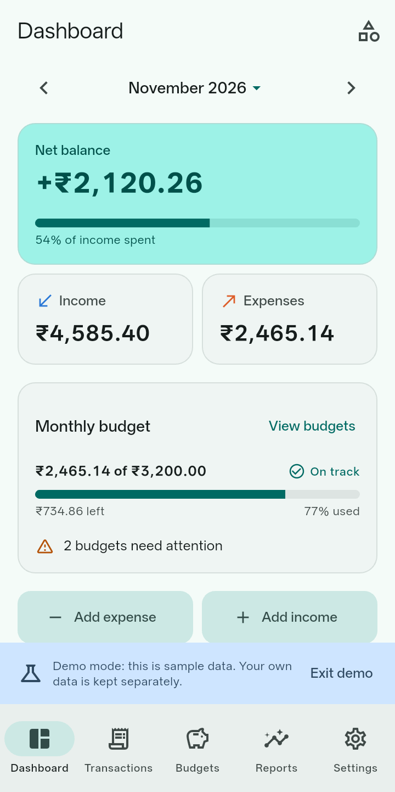 | 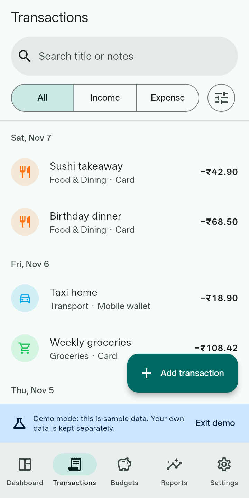 | 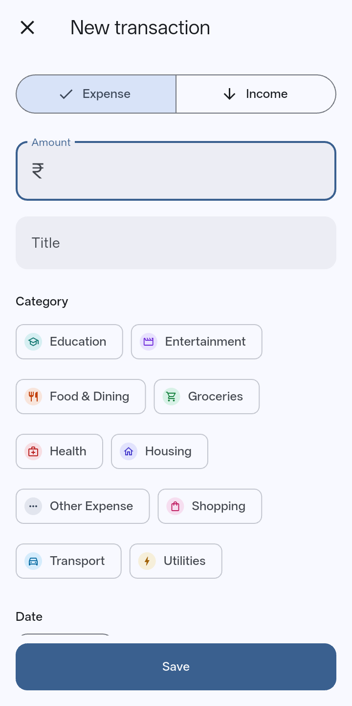 | 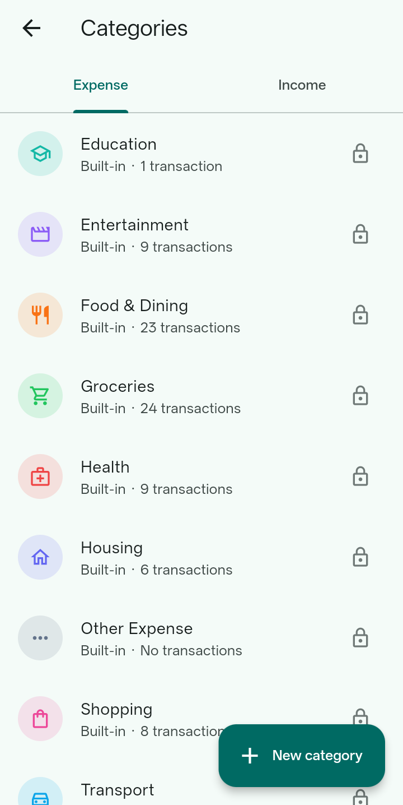 |

| Budgets | Reports | Settings | Arabic (right-to-left) |
|---|---|---|---|
| 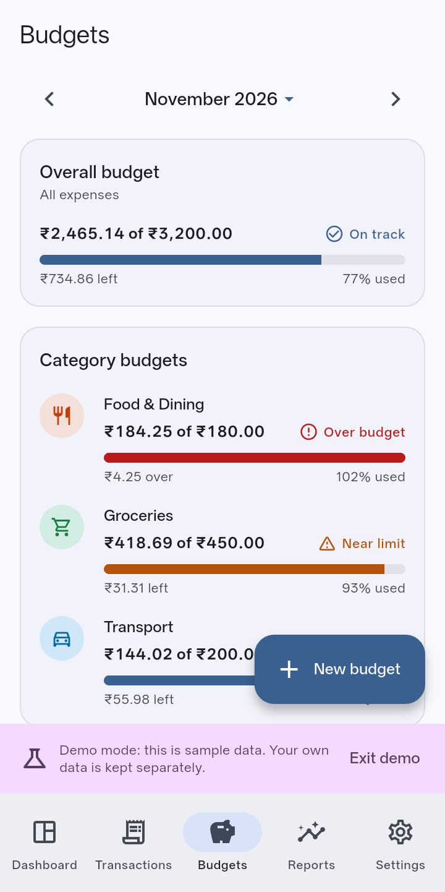 | 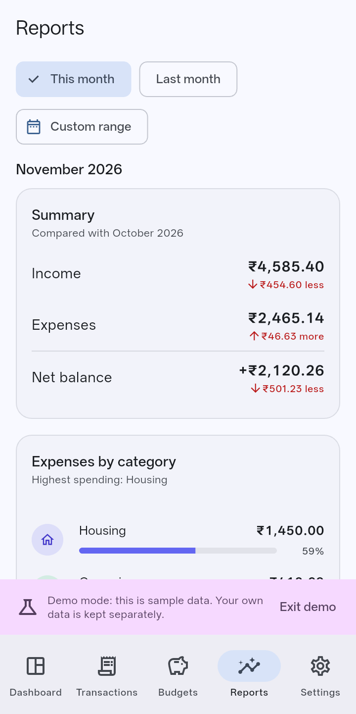 | 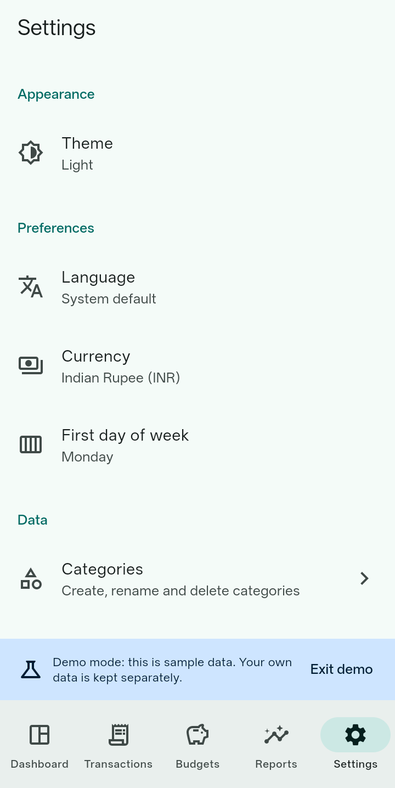 | 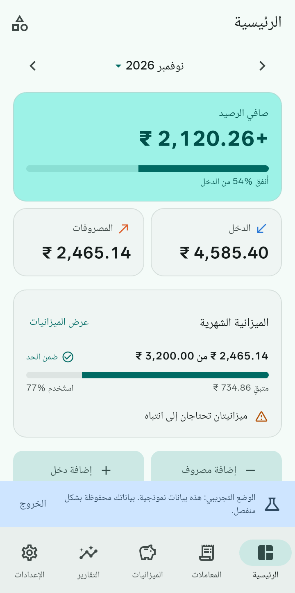 |

## Feature demos

| Add an expense | Search and filter | Budgets and reports | CSV import |
|---|---|---|---|
| 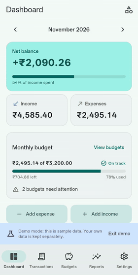 | 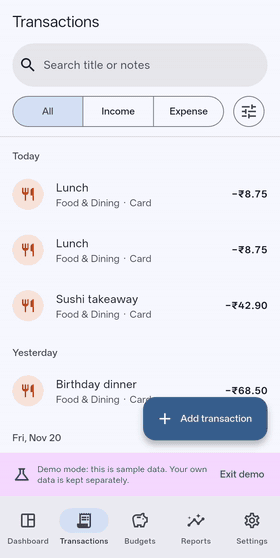 | 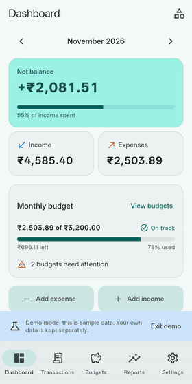 | 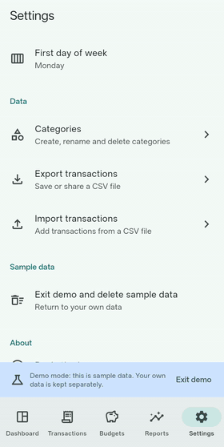 |

## Features

| Area | What it does |
|---|---|
| Transactions | Add, edit and delete income and expenses with title, amount, category, date, payment method and notes. Search, filter (type, categories, payment methods, date range) and sort. |
| Categories | 15 built-in categories plus your own, with icon and colour. Deleting a category that is in use moves its transactions to another category of the same type. |
| Budgets | Monthly limits for all spending or one expense category. They recur every month, can be changed from the current month on or turned off, and past months keep the limits they had. On-track, near-limit and over-budget states use an icon and a label, not colour alone. Optional budget alerts send a phone notification when a budget reaches a level you choose (50–100 %). |
| Dashboard | Month summary (income, expenses, net balance), budget progress, spending by category, a six-month income-vs-expense chart and recent transactions. |
| Reports | This month, last month or a custom range: comparison with the previous period, breakdowns by category, monthly trends and budget performance. |
| CSV export | Export everything or a date range and share or save it through the system share menu. Opens in Excel, Numbers and Google Sheets. |
| CSV import | Import an exported file, in any of the app's languages, or a spreadsheet saved as CSV. Shows what will be added first and skips transactions already in the app. |
| Sample data | An optional demo mode with six months of realistic data, kept completely separate from your own records. |
| Settings | Language, theme (system, light, dark), display currency (17 currencies), decimals in shortened amounts, and first day of the week. |

## How it's built

| Purpose | Technology |
|---|---|
| UI | Flutter, Dart, Material 3 |
| State management | `flutter_bloc` (Cubit) |
| Database | Drift on SQLite, with schema snapshots and migration tests |
| Charts | `fl_chart` |
| Notifications | `flutter_local_notifications`, for optional on-device budget alerts |
| Localisation | Flutter `gen-l10n` with ARB files; right-to-left layout for Arabic |
| Testing | `flutter_test`, `bloc_test`, `mocktail`, in-memory SQLite |
| CI | GitHub Actions: format, static analysis, tests and generated-code checks on every change |

Design in brief:

- **Layered:** screens render state from Cubits; Cubits call repositories;
  repositories apply the business rules; only data-source classes touch the
  database. Dependencies are passed in explicitly, with no service locator.
- **Data integrity in the database:** foreign keys, check constraints and
  one database transaction per multi-step change (for example, moving a
  deleted category's transactions), so the data can never end up half
  updated.
- **Effective-dated budgets:** each budget keeps a history of versions; the
  limit for a month is the latest version on or before it, so nothing has
  to run on a schedule.
- **Safe updates:** the schema is versioned and tested against stored
  snapshots, and a contract test pins file names and settings keys so an
  app update never loses data.

## Privacy and terms

- [Privacy policy](docs/PRIVACY_POLICY.md) — the app collects and sends no
  data.
- [Terms of use](docs/TERMS_OF_USE.md)

## Copyright

© 2026 Bharavi Vaghjiyani. All rights reserved. The screenshots, recordings
and documents in this repository may not be reused without permission.
